# Flyerrr Current-State System Architecture

This is the rendered architectural diagram for the Project Architecture Baseline. It shows the system boundary, user roles, major runtime components, dependency direction, persistence layer, and the missing backend boundary.

## Diagram interpretation

- **System type:** browser-only React single-page application.
- **Runtime boundary:** all application logic and persistence execute in the user's browser.
- **Presentation layer:** route components provide separate student and organization-officer workflows and reuse shared UI components.
- **State layer:** React contexts hold authentication, follow, and theme state.
- **Data layer:** route components call `appDatabase.ts`, `checkInStore.ts`, and `attendanceStore.ts` directly.
- **Persistence layer:** the data and context modules read and write seven `localStorage` keys.
- **External boundary:** no backend API, shared database, server-side authorization, or cross-device persistence exists in the current implementation.

Solid arrows represent implemented runtime calls or data flow. The dashed red arrow identifies the backend boundary that the prototype does not implement.

## Evidence in the repository

| Diagram component | Repository evidence |
|---|---|
| Application shell and routes | `src/App.tsx` |
| Student and officer workflows | `src/pages/` |
| Shared presentation components | `src/components/` |
| Client state | `src/contexts/` |
| Data-access modules | `src/data/appDatabase.ts`, `src/data/checkInStore.ts`, `src/data/attendanceStore.ts` |
| Seed data | `src/data/mockEvents.ts` |
| Browser persistence | `localStorage` calls in the contexts and data modules |
| Missing server tier | No API client, server package, database client, or network request exists under `src/` |

The editable Mermaid source is [`flyerrr-current-system-architecture.mmd`](diagrams/flyerrr-current-system-architecture.mmd).
