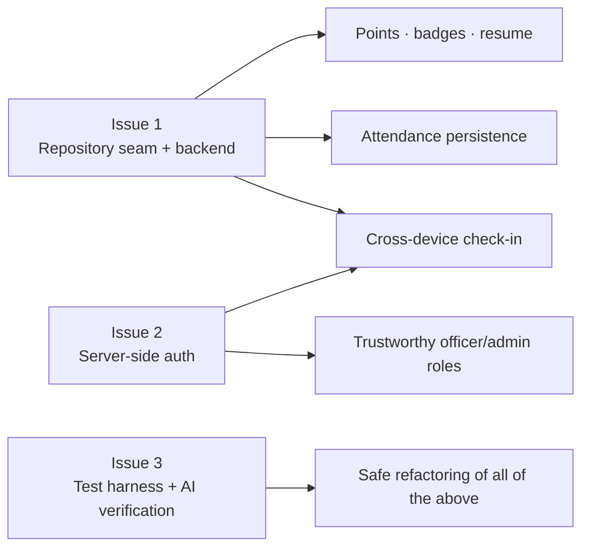

# Backlog Integration — Top 3 Technical Debt Items

**Assignment:** Risk & Technical Debt Inventory, Part 3 (Backlog Integration)
**Module:** 1 — Senior Project II Reset: From Prototypes to Products
**Repository:** `github.com/oanyamele/campus-pulse`
**Verified against:** commit `f6c7136` on `main` · re-measured 2026-09-17

---

## Purpose of this document

Part 3 of the assignment requires the top three technical debt items to be converted into
real GitHub Issues, labeled, and refined with LLM-drafted acceptance criteria. This file
holds the **exact issue bodies, ready to paste** into the GitHub web UI, plus the evidence
table to fill in once they exist.

Each issue below is a remediation of debt identified in
[`docs/PROJECT_RESET_REPORT.md`](./PROJECT_RESET_REPORT.md). None of them is a new feature.
They were selected as the top three because every other blocking defect in the audit
depends on at least one of them:



### How to create these issues

1. Go to `github.com/oanyamele/campus-pulse/issues/new`
2. Create the labels first (Issues → Labels → New label):
   `technical-debt`, `refactor`, `P0-blocking`, `security`, `testing`, `backend`
3. Paste the **Title** and **Body** for each issue below
4. Apply the listed labels, assign an owner, and add the issue to the Project Board
5. Record the resulting URLs in the [evidence table](#evidence-of-completion) at the bottom

---

## Issue 1

**Title**

```text
Refactor: introduce a data-access seam so pages stop importing localStorage directly
```

**Labels:** `technical-debt` · `refactor` · `architecture` · `P0-blocking` · `backend`

**Body**

````markdown
## Category
Architectural Debt

## Problem

The prototype has no server tier and no abstraction in front of storage. Route
components import the storage module directly, so there is no seam at which a real API
can be introduced.

**Verified evidence (commit `f6c7136`, measured 2026-09-17):**

- `0` occurrences of `fetch(`, `axios`, `supabase`, or `firebase` across 87 TypeScript
  files / 6,814 lines. The network boundary is never crossed.
- Page components import storage functions directly rather than through a service layer,
  for example `src/pages/Saved.tsx:2` (`import { mockEvents } from "@/data/mockEvents"`)
  and `src/pages/Explore.tsx:4` (`import { mockOrgs, mockEvents } from "@/data/mockEvents"`).
- `src/pages/Explore.tsx:14` searches the static `mockEvents` seed array, so an event an
  officer creates through `CreateEvent` is **never discoverable by search**.
- `src/pages/Saved.tsx:8` filters `mockEvents.filter((e) => e.saved)`; nothing in the app
  ever sets `saved = true`, so the Saved screen is permanently empty.
- All state lives in `window.localStorage` under 7 keys spanning two naming conventions
  (`flyer_db_v1`, `flyer_rsvp_v1`, `flyer_reminders_v1`, `flyer_checkin_tokens_v1`,
  `flyerrr_auth`, `flyerrr_follows`, `flyerrr_theme`).
- `QueryClientProvider` is mounted in `src/App.tsx` but **zero queries** have been written;
  pages read synchronously during render.

## Why this is the top priority

This is the root cause the audit traces every other blocking defect back to. Cross-device
check-in, attendance persistence, points, badges, and the resume generator are all
downstream of it. Without a seam, swapping storage for an API later is one high-risk
cutover across every page instead of an incremental, page-by-page migration.

## Remediation plan

Introduce repository interfaces between pages and storage **before** the backend lands, so
the migration can proceed one page at a time with the existing localStorage code demoted
to a test and offline adapter.

1. Define `EventRepository`, `AttendanceRepository`, and `UserRepository` interfaces
2. Implement `LocalStorageRepository` by moving today's `src/data/` logic behind it
3. Add `HttpRepository` speaking to the new API, selected by environment config
4. Wrap access in TanStack Query hooks (`useEvents`, `useEvent`, `useCreateEvent`)
5. Migrate pages one at a time until no page imports `src/data/` directly

## Acceptance criteria

*Drafted with LLM assistance, then reviewed and edited by the team — see the AI-Aware
Refinement note in `docs/BACKLOG_INTEGRATION.md`.*

- [ ] `EventRepository`, `AttendanceRepository`, and `UserRepository` interfaces exist and
      are the only documented way to read or write domain data
- [ ] Two implementations exist: `LocalStorageRepository` and `HttpRepository`
- [ ] The active implementation is chosen by environment configuration, not by an import
- [ ] `grep -r "@/data/" src/pages/` returns **no** results
- [ ] Event queries flow through TanStack Query hooks with loading and error states
      rendered (no synchronous reads during render)
- [ ] An event created by an officer is immediately visible in both the feed **and**
      Explore search, without a manual page refresh
- [ ] Saving an event persists and survives a reload, and the Saved screen lists it
- [ ] `LocalStorageRepository` has unit tests covering every interface method
- [ ] `npx tsc --noEmit -p tsconfig.app.json` and `npm run build` both still pass
- [ ] An ADR at `docs/adr/0001-backend-stack.md` records the chosen stack, at least three
      options considered, and the consequences

## Definition of done

Two students on two different devices see the same officer-created event, and swapping the
repository implementation requires no changes to any page component.

## Estimate

13 story points (5 for the seam, 8 for the API and database it fronts)

## Traces to

Risks R-04, R-10, R-19 in `docs/PROJECT_RESET_REPORT.md`
````

---

## Issue 2

**Title**

```text
Refactor: move authentication server-side and stop storing plaintext passwords
```

**Labels:** `technical-debt` · `refactor` · `security` · `P0-blocking` · `backend`

**Body**

````markdown
## Category
Architectural Debt (with a direct security and ethics consequence)

## Problem

Authentication was generated as a client-side demo convenience and never revisited.
Credentials are stored in plaintext in the browser, and authorization is enforced only by
a value the user can edit.

**Verified evidence (commit `f6c7136`, measured 2026-09-17):**

- `src/data/appDatabase.ts:9` declares `password: string` on the user record, and that
  record is serialized straight into `localStorage['flyer_db_v1']`. Every account's
  password is readable from the DevTools Application panel.
- `src/data/appDatabase.ts:62` and `:72` seed demo accounts with the literal password
  `"password123"`.
- `src/data/appDatabase.ts:187` authenticates with a plaintext string comparison:
  `user.password === input.password`. There is no hashing anywhere in the codebase.
- `src/App.tsx:28-30` — `ProtectedRoutes` renders based solely on `auth.isLoggedIn`, which
  is read from `localStorage['flyerrr_auth']`. Pasting the following into the browser
  console grants full officer privileges, including the verification queue, attendance
  reports, and event creation:
  ```js
  localStorage.setItem('flyerrr_auth', '{"isLoggedIn":true,"role":"org_officer"}')
  ```
- There is no server, so no authorization decision can currently be enforced anywhere the
  user cannot reach.

## Why this matters beyond code quality

Students reuse university passwords. Storing them in plaintext is a privacy and ethics
exposure, not a style problem, and it cannot ship to real users under any circumstances.
The bypassable role check compounds it: the organization verification queue is an
administrative trust decision currently protected by an editable string.

## Remediation plan

1. Stand up authentication endpoints on the API introduced in Issue 1
2. Hash passwords with bcrypt or argon2, server-side only
3. Issue short-lived session tokens as httpOnly cookies
4. Enforce role and ownership checks on **every** privileged endpoint, server-side
5. Keep client-side route guards for user experience only, never as the security boundary
6. Reset or migrate the existing seed accounts; remove the hardcoded demo passwords

## Acceptance criteria

*Drafted with LLM assistance, then reviewed and edited by the team.*

- [ ] Passwords are hashed with bcrypt or argon2 and only ever handled server-side
- [ ] No password, password hash, or long-lived credential is written to any client storage
- [ ] `grep -rn "password" src/` shows no plaintext credential storage or comparison
- [ ] Sessions use httpOnly cookies (or equivalently short-lived tokens) with documented
      expiry and a working revocation path
- [ ] Every privileged endpoint independently verifies role and resource ownership
- [ ] **Bypass test:** editing `localStorage['flyerrr_auth']` to claim
      `"role":"org_officer"` grants no additional access; the attempt is rejected
      server-side and covered by an automated test
- [ ] Login failures return a generic message that does not reveal whether an account exists
- [ ] Login attempts are rate-limited
- [ ] Hardcoded `"password123"` seed credentials are removed from the repository
- [ ] Authentication and authorization events are audit-logged with actor and timestamp

## Definition of done

An automated test proves that a user who tampers with client state cannot read or modify
another user's data or reach any officer-only screen or endpoint.

## Estimate

8 story points (depends on Issue 1)

## Traces to

Risks R-03, R-05 in `docs/PROJECT_RESET_REPORT.md`
````

---

## Issue 3

**Title**

```text
Test debt: establish a real test harness and a verification protocol for AI-generated code
```

**Labels:** `technical-debt` · `refactor` · `testing` · `P0-blocking`

**Body**

````markdown
## Category
Test Debt

## Problem

The prototype has the *appearance* of a test setup — Vitest, Testing Library, and
Playwright are all configured — but nothing is actually verified. One of the config files
imports a package that does not exist, which is why nobody noticed E2E has never run.

**Verified evidence (commit `f6c7136`, measured 2026-09-17):**

- `src/test/example.test.ts` is the only test file. Its single assertion is
  `expect(true).toBe(true)`. `npm test` reports `1 passed` against 6,814 lines of source,
  so the green result is meaningless.
- `playwright.config.ts:1` imports `lovable-agent-playwright-config/config`. **That package
  is not in `package.json` and is not present in `node_modules`.** It is a hallucinated
  dependency, so `npx playwright test` cannot resolve its own configuration and E2E has
  never executed once. `playwright-fixture.ts` imports it too.
- `npx eslint .` reports **16 problems (5 errors, 11 warnings)**, including two genuine
  correctness bugs: `src/pages/EventDetail.tsx:38` and `:43` call `useEffect`
  conditionally, after an early return at line 26. React will throw *"Rendered fewer hooks
  than expected"* if the component instance is reused when navigating from a valid event
  to an invalid one.
- Type safety is disabled, so a passing typecheck proves very little:
  `tsconfig.app.json:25` sets `strict: false`, `tsconfig.json:13` sets
  `strictNullChecks: false`, and both disable `noImplicitAny`, `noUnusedLocals`, and
  `noUnusedParameters`.
- `12` of `36` commits (33%) were authored by `gpt-engineer-app[bot]` or `Lovable`. There is
  no `CODEOWNERS` file and no branch protection on `main`, so AI-authored code has merged
  with no required human review.
- Pure, easily testable logic sits completely uncovered, including
  `buildAttendanceCsv` (`src/data/attendanceStore.ts:101`) and `getAttendanceSummary`
  (`:122`).

## Why this blocks the other two issues

Issues 1 and 2 are large refactors of code the team did not write. Refactoring 6,814 lines
with one tautological test is how a working prototype becomes a broken one. This issue is
the safety net that makes the other two survivable, and it is also the "trust but verify"
protocol the VIBE workflow requires for AI-generated components.

## Remediation plan

1. Delete the tautological example test
2. Fix the Playwright configuration — add the missing dependency if it genuinely exists, or
   replace it with a standard `@playwright/test` config
3. Fix the two conditional-hook errors in `EventDetail.tsx`
4. Unit-test `src/data/` first: it is pure, has no UI, and is the cheapest coverage
5. Add an E2E path covering login through check-in
6. Remove `continue-on-error` from the lint step in `.github/workflows/ci.yml` so lint
   failures actually block a merge
7. Adopt a written verification protocol for AI-generated code and enforce it with
   `CODEOWNERS` plus branch protection

## Acceptance criteria

*Drafted with LLM assistance, then reviewed and edited by the team.*

- [ ] `src/test/example.test.ts` is deleted
- [ ] `npx playwright test` runs without a module-resolution error
- [ ] `npx eslint .` reports **0 errors** (warnings may remain, tracked separately)
- [ ] Both `useEffect` calls in `EventDetail.tsx` run unconditionally; navigating to
      `/event/does-not-exist` shows an empty state without crashing, covered by a test
- [ ] `src/data/` has at least 60% line coverage, enforced in CI
- [ ] `buildAttendanceCsv` is tested for comma, quote, and newline escaping
- [ ] `getAttendanceSummary` is tested including the empty-input case
- [ ] Check-in token issue, validate, expire, reuse, and tamper paths are all covered
- [ ] One E2E test covers: sign up, sign in, browse feed, RSVP, and check in
- [ ] The lint step in `.github/workflows/ci.yml` no longer uses `continue-on-error`
- [ ] Branch protection on `main` requires the `verify` check and at least one approving review
- [ ] A `CODEOWNERS` file assigns a human reviewer to `src/data/` and `src/contexts/`
- [ ] `CONTRIBUTING.md` documents the AI-code verification protocol: what a human must
      check before approving agent-generated code, including that every imported package
      actually exists in `package.json`

## Definition of done

CI fails when someone breaks the check-in logic, and no AI-generated pull request can merge
without a named human reviewer signing off.

## Estimate

13 story points

## Traces to

Risks R-07, R-08, R-09, R-17, R-18 in `docs/PROJECT_RESET_REPORT.md`
````

---

## AI-Aware Refinement note

The assignment requires using an LLM to help draft the acceptance criteria. Here is how
that was done and, more importantly, where the team had to override the model.

**Process.** Each debt item was given to the agent with its verified evidence (file paths,
line numbers, and command output) and a request for testable acceptance criteria. The agent
had read access to the repository, so it could ground criteria in real symbol names such as
`buildAttendanceCsv` and real configuration flags such as `strictNullChecks`.

**What the LLM did well.** It reliably converted a vague intent like "fix the auth" into
falsifiable checks, and it suggested edge cases the team had not written down — CSV quote
and newline escaping, the `getAttendanceSummary` empty-input case, and generic login errors
to prevent account enumeration.

**Where the team corrected it.** This is the part that matters for the VIBE *Verify* step:

| LLM tendency | Team correction |
|---|---|
| Wrote criteria that restate the plan ("implement a repository layer") | Rewritten as observable checks a reviewer can run, e.g. `grep -r "@/data/" src/pages/` returns nothing |
| Proposed a blanket "80% test coverage" target | Narrowed to 60% on `src/data/` specifically, because a global target across 3,491 lines of unused shadcn/ui files measures nothing useful |
| Suggested adding tests for the four attendance screens as they exist | Rejected — those screens read hardcoded arrays, so testing them would lock in the defect. Sequenced behind Issue 1 instead. |
| Omitted the bypass test in Issue 2, describing only what to build | Added the explicit adversarial criterion: editing `localStorage` must grant no access |
| Initially accepted `lovable-agent-playwright-config` as a real package | Team verified against `package.json` and `node_modules` and confirmed it does not exist — which is what turned this from a config annoyance into documented evidence of hallucination |

The last row is the point of the exercise. An agent asked to reason about the Playwright
setup treated the import as valid because it looked plausible. Only running
`Test-Path node_modules/lovable-agent-playwright-config` settled it. Every factual claim in
these three issues was confirmed by executing something against the repository, not by
asking the model whether it was true.

---

## Evidence of completion

Fill this in after creating the issues, and attach a screenshot of the Project Board to the
individual PDF submission.

| # | Issue title | Issue URL | Labels applied | Assignee | On board |
|---|---|---|---|---|---|
| 1 | Refactor: introduce a data-access seam… | _paste URL_ | | | ☐ |
| 2 | Refactor: move authentication server-side… | _paste URL_ | | | ☐ |
| 3 | Test debt: establish a real test harness… | _paste URL_ | | | ☐ |

**Board checklist**

- [ ] All three issues appear on the GitHub Project Board
- [ ] Each carries the `technical-debt` label
- [ ] Each has an owner assigned
- [ ] Each has an estimate recorded
- [ ] Each is placed in a sprint / milestone
- [ ] Screenshot of the board captured for the submission

---

## Verified metrics referenced above

All figures re-measured on 2026-09-17 against commit `f6c7136`.

| Metric | Value | How it was measured |
|---|--:|---|
| TypeScript source files | 87 | recursive count of `*.ts`, `*.tsx` under `src/` |
| TypeScript source lines | 6,814 | line count of the same set |
| `fetch` / `axios` / `supabase` / `firebase` occurrences | 0 | pattern search across `src/` |
| Route components | 16 files / 1,728 lines | `src/pages/` |
| Data layer | 4 files / 691 lines | `src/data/` |
| shadcn/ui components | 49 files / 3,491 lines | `src/components/ui/` |
| Unused UI components | 34 of 49 | import-site cross-reference |
| Unreferenced shared components | 3 | `EventDetailModal`, `FilterBar`, `NavLink` — 0 import sites |
| Test files / meaningful assertions | 1 / 0 | `npm test` → `1 passed` |
| Typecheck result | 0 errors | `npx tsc --noEmit -p tsconfig.app.json` |
| ESLint result | 16 problems (5 errors, 11 warnings) | `npx eslint .` |
| Production JS bundle | 544.69 kB (167.70 kB gzip) | `npm run build` |
| Chunk-size warning | present (>500 kB) | same build output |
| Commits, all branches | 36 | `git log --all` |
| AI-authored commits | 12 (33%) | 11 `gpt-engineer-app[bot]` + 1 `Lovable` |
| `CODEOWNERS` file | absent | `Test-Path .github/CODEOWNERS` |
| ADR directory | absent | `Test-Path docs/adr` |
| Committed lockfiles | 3 | `bun.lock`, `bun.lockb`, `package-lock.json` |
| Hallucinated dependency | 1 | `lovable-agent-playwright-config`, absent from `package.json` and `node_modules` |

**One figure could not be re-verified.** `npm audit --production` failed on this machine
with `unable to verify the first certificate` against `registry.npmjs.org`. The August
audit recorded 11 advisories (10 high, 1 moderate). Treat that number as carried forward,
not re-confirmed, and re-run the audit in CI where the certificate chain resolves.

Two figures from the August report are now **stale and corrected here**: total commits have
grown from 26 to 36, so AI-authored share is 33% rather than 42%; and source lines measured
strictly over `*.ts`/`*.tsx` are 6,814 rather than the previously reported ~7,623.
