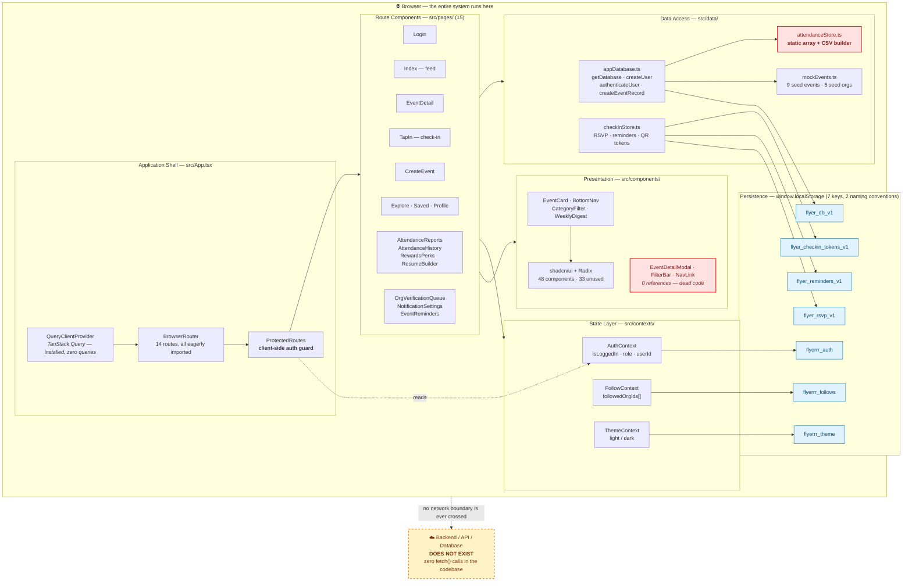
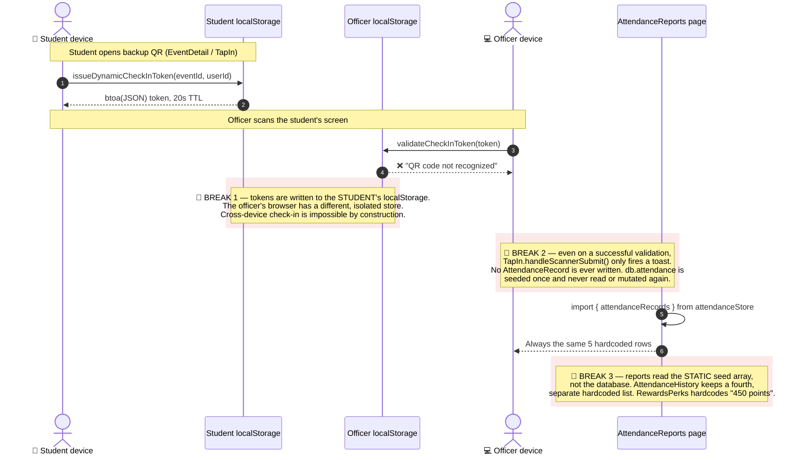
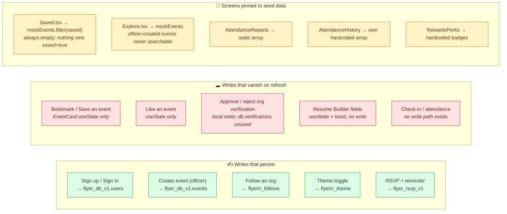
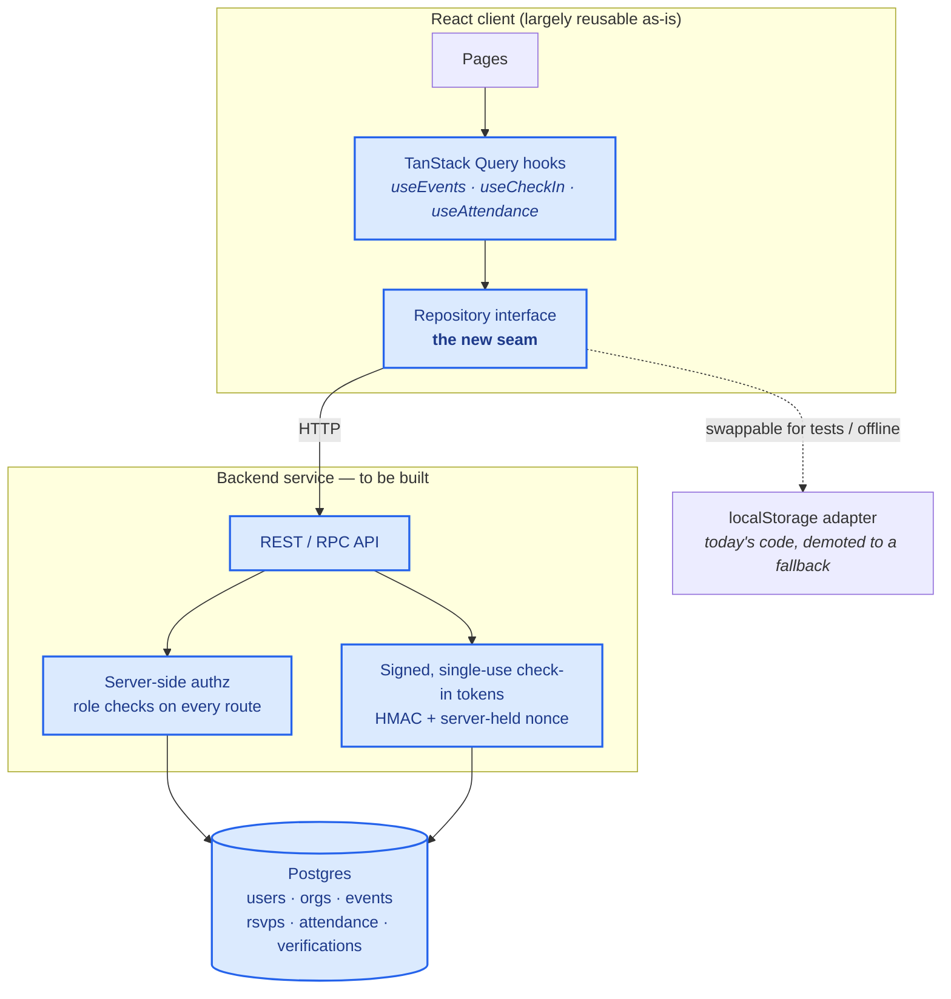

# flyerrr — System Architecture Baseline

> Generated for **Deliverable 1: Project Reset & Architecture Baseline**
> Repository: `oanyamele/flyerrr` · Branch `main` @ `f0c475a` · Audited 2026-08-27
> Diagrams are Mermaid and render natively on GitHub.

---

## 1. Current System Architecture (as built)

Every box below is a file that exists in the repo today. There is **no server tier** — the
"database" is a JSON blob in the browser's `localStorage`.

### Dependency direction

`pages → contexts → localStorage` and `pages → data → localStorage`. There is no
service/repository abstraction between a route component and the storage engine, so
swapping `localStorage` for a real API in Senior Project II means editing every page
that touches data.

---

## 2. Data Flow — the check-in loop, and where it breaks

This is the app's core value proposition (*attend → check in → earn points → build resume*).
Tracing it end-to-end reveals **three severed links**.

**Consequence:** every attendance, points, badge and resume number in the product is
cosmetic. No user action anywhere in the app can change them.

---

## 3. Persistence Topology — what actually survives a refresh

---

## 4. Target Architecture for Senior Project II

The minimum change that makes the product real: introduce a server tier and a
repository seam so pages stop importing storage directly.

**Why the seam first:** today 15 page components each `import { listEventRecords }` and
friends directly. Introducing `REPO` before the backend lets the team migrate page-by-page
instead of in one high-risk cutover, and makes the data layer testable — which is what
unblocks the 0% test coverage problem.

---

## 5. Technology Inventory

| Layer | Technology | Version | Notes |
|---|---|---|---|
| Build | Vite + `@vitejs/plugin-react-swc` | 5.4.19 | Requires Node ≥ 20; no `.nvmrc` in repo |
| Language | TypeScript | 5.8.3 | `strict: false`, `strictNullChecks: false` |
| UI | React | 18.3.1 | |
| Routing | react-router-dom | 6.30.1 | 14 routes, no lazy loading |
| Styling | Tailwind CSS | 3.4.17 | HSL token system, light + dark |
| Components | shadcn/ui + Radix | 48 files | 33 unused |
| Server state | TanStack Query | 5.83.0 | Provider mounted, **zero queries written** |
| Animation | framer-motion | 11.0.0 | |
| Forms | react-hook-form + zod | 7.61 / 3.25 | Installed; Login/CreateEvent use raw `useState` |
| Unit test | Vitest + Testing Library | 3.2.4 | 1 tautological test |
| E2E | Playwright | 1.57 | **Config imports an uninstalled package** |
| Codegen | `lovable-tagger` | 1.1.13 | Vendor coupling in the build pipeline |
| Backend | — | — | **None** |
