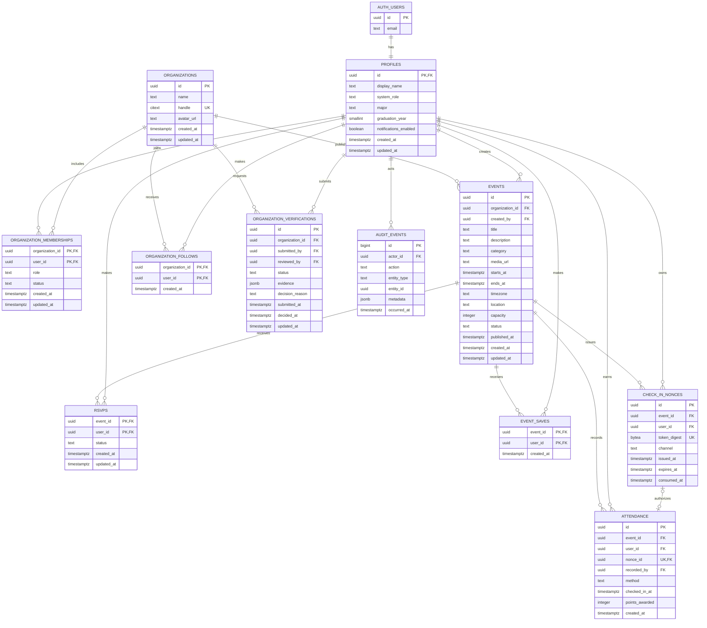

# Flyerrr relational schema

- **Status:** Proposed — pending four-person team approval
- **Schema owner:** Brian-Two
- **Reviewers:** oanyamele, neaylasimone, nadcaesar
- **Date:** September 10, 2026
- **Related issue:** [#13](https://github.com/oanyamele/flyerrr/issues/13)
- **Database target:** PostgreSQL

## Goals

This design replaces device-local JSON with a shared relational system of record.
It supports the current event experience and the cross-device attendance loop while
making ownership, authorization, time, and uniqueness explicit.

The schema must guarantee that:

- users authenticate outside application tables;
- organization permissions are membership-scoped;
- events have machine-readable start and end instants;
- one user can RSVP, save, follow, or attend only once per target;
- QR and NFC retries cannot create duplicate attendance or points;
- verification decisions have an accountable reviewer and audit trail; and
- reports can be generated from normalized records rather than stored counters.

## Entity-relationship diagram



## Table contract

### `profiles`

`profiles.id` is a one-to-one foreign key to the authentication provider's user ID.
Passwords and password hashes never belong in this table. `system_role` is restricted
to `student` or `admin`; organization authority comes from memberships rather than a
client-selected global role. `graduation_year`, when present, is constrained to a
reasonable four-digit range.

### `organizations` and `organization_memberships`

Organization handles are case-insensitively unique. A membership is unique on
`(organization_id, user_id)`, has a role of `member` or `leader`, and has a status of
`pending`, `active`, or `revoked`. Only active leaders can create or manage an event for
that organization.

Verification is not a mutable boolean on the organization. Current verification state
is derived from the newest valid decision in `organization_verifications`, so the system
retains who decided, when, and why.

### `events`

Required constraints:

- `ends_at > starts_at`;
- `capacity > 0` when capacity is present;
- `category` is one of `social`, `academic`, `career`, `sports`, `arts`, or `other`;
- `status` is one of `draft`, `published`, `cancelled`, or `archived`;
- `published_at` is present only for an event that has been published; and
- `timezone` is a non-empty IANA zone such as `America/New_York`, validated by the
  application before insert or update.

Attendee, like, and follower counts are computed from related rows or a clearly named
cache/materialized view. They are not source-of-truth columns on `events`.

### `rsvps`, `event_saves`, and `organization_follows`

Each join table uses a composite primary key, making repeated actions idempotent:

- `rsvps`: `(event_id, user_id)`;
- `event_saves`: `(event_id, user_id)`; and
- `organization_follows`: `(organization_id, user_id)`.

RSVP status is `going` or `cancelled`, retaining lifecycle history without creating
duplicate rows. Saves and follows may be deleted when the user reverses the action.

### `organization_verifications`

Status is `pending`, `approved`, or `rejected`. Pending rows have no reviewer,
decision reason, or decision time. Decided rows require `reviewed_by` and `decided_at`;
rejections also require a non-empty reason. A partial unique index permits at most one
pending request per organization.

### `check_in_nonces` and `attendance`

The server stores only a digest of the signed credential. A nonce expires after its
short validity window and can be consumed once. Token issue and validation use database
time rather than the device clock.

Attendance has a unique constraint on `(event_id, user_id)` and a unique nullable
`nonce_id`. Consuming the nonce and inserting attendance happen in one transaction.
Retries return the existing attendance result and never grant points twice.
`recorded_by` is required for an administrative/manual check-in and otherwise may be
null when the signed student credential is the authority.

### `audit_events`

Append-only records capture security-relevant changes such as verification decisions,
role changes, event publication, rejected check-in attempts, and manual attendance.
Audit metadata must not contain credentials, raw tokens, or unnecessary personal data.

## Timestamp and timezone policy

1. Every real-world instant is stored as PostgreSQL `timestamptz`.
2. Event boundaries are named `starts_at` and `ends_at`; display-only `date` and `time`
   strings are not persisted as the source of truth.
3. PostgreSQL normalizes instants internally. APIs serialize them as ISO 8601/RFC 3339
   strings with an explicit `Z` or numeric offset, for example
   `2026-09-12T22:00:00Z`.
4. Each event also stores its IANA `timezone`. The client formats `starts_at` and
   `ends_at` in that zone so daylight-saving changes remain correct.
5. User-entered local date and time values are converted with the selected IANA zone on
   the server. Ambiguous or nonexistent daylight-saving times are rejected for explicit
   correction rather than guessed.
6. `created_at`, `updated_at`, `submitted_at`, `decided_at`, `issued_at`, `expires_at`,
   `consumed_at`, `checked_in_at`, and `occurred_at` are database-generated
   `timestamptz` values unless an audited migration supplies an original instant.
7. Expiry, event-window, and ordering comparisons use database time.
8. Calendar-only concepts, if added later, use PostgreSQL `date`; durations use an
   integer number of seconds or a PostgreSQL interval, never a formatted string.

## Required indexes

- `events (starts_at, id) WHERE status = 'published'` for the upcoming feed;
- `events (organization_id, starts_at DESC)` for organization pages;
- `events (category, starts_at, id) WHERE status = 'published'` for filters;
- `rsvps (user_id, status, created_at DESC)`;
- `event_saves (user_id, created_at DESC)`;
- `organization_follows (user_id, created_at DESC)`;
- `attendance (event_id, checked_in_at DESC)` for live dashboards and exports;
- `attendance (user_id, checked_in_at DESC)` for student history;
- `organization_verifications (submitted_at) WHERE status = 'pending'`; and
- `check_in_nonces (expires_at) WHERE consumed_at IS NULL` for cleanup.

Foreign-key columns not covered by the indexes above receive supporting indexes before
production data is loaded.

## Authorization outline

- Signed-out users may read only published, public events and approved public
  organization profiles.
- Students may update their own profile and manage only their own RSVP, save, follow,
  and check-in credential records.
- Active organization leaders may manage events and reports only for organizations in
  which they have an active leader membership.
- Administrators may review verification requests, but cannot rewrite historical audit
  or attendance records.
- Privileged attendance and verification transitions execute through server-side
  functions with explicit authorization and transactional checks.

Every exposed table uses grants plus Row Level Security. Authorization tests must cover
allow and deny cases for signed-out users, students, leaders from the owning
organization, leaders from another organization, and administrators.

## Seed-event migration path

The ticket was written when the repository had nine seed events. The current
`src/data/mockEvents.ts` contains **10 events** and five organizations, so the migration
must inventory the checked-in source instead of relying on the stale count.

### Source problems that block direct insertion

- event IDs and organization IDs are short fixture strings rather than UUIDs;
- `date` omits the year and timezone;
- `time` omits the timezone;
- no end time exists;
- `attendees`, `likes`, and `followerCount` are unexplained aggregate numbers;
- `friendsGoing` contains names without stable user identities; and
- `saved` is global fixture state even though saves must be user-specific.

### Migration procedure

1. **Freeze and audit the source.** Export the current five organizations and 10 events
   to a versioned JSON fixture. Record its commit SHA and row counts in the migration.
2. **Preserve traceability.** Create deterministic UUIDs for fixture organizations and
   events from their legacy IDs, or maintain a temporary unique `legacy_id` mapping
   table. The migration must be idempotent.
3. **Confirm time data.** The schema owner supplies an explicit manifest containing
   `legacy_event_id`, calendar year, local start, local end, and IANA timezone for every
   event. The current strings are insufficient to infer these values safely. The import
   fails if any value is missing or if `ends_at <= starts_at`.
4. **Convert instants.** Convert each reviewed local boundary with its IANA zone and
   insert the resulting `timestamptz` values. Read them back as ISO 8601 strings and
   compare them to the approved manifest.
5. **Import normalized organizations and events.** Map `org.id` to
   `organization_id`; map title, description, image, category, location, capacity, and
   tags to their normalized destinations. Seed events enter as `draft` unless a reviewer
   explicitly approves publishing them.
6. **Do not fabricate relationships.** Do not turn aggregate attendee/follower/like
   counts, `friendsGoing`, or global `saved` flags into attendance, users, follows,
   likes, or event saves. Preserve the raw values only in the archived fixture for UI
   comparison.
7. **Treat verification as a decision.** Do not convert the fixture `verified` boolean
   into an unaudited approval. Create an approved verification record only when a named
   reviewer confirms the fixture organization; otherwise leave it pending/unverified.
8. **Handle existing demo attendance separately.** The five records in
   `attendanceStore.ts` reference legacy events and synthetic attendees. Load them only
   into local/demo environments after deterministic demo users exist; never mix them
   into production attendance.
9. **Verify the migration.** Assert five organizations and 10 events, zero duplicate
   legacy IDs, valid foreign keys, valid event ranges, expected categories and
   capacities, and zero fabricated attendance/follow/save rows.
10. **Cut over through the repository interface.** Compare feed results between the
    archived fixture and PostgreSQL, then switch the data adapter. Keep rollback limited
    to the adapter configuration and reversible migrations; do not dual-write browser
    storage and PostgreSQL.

### Migration acceptance queries

The executable migration must include automated equivalents of these checks:

```sql
select count(*) = 5 as organization_count_ok from organizations;
select count(*) = 10 as event_count_ok from events;

select count(*) = 0 as invalid_event_ranges
from events
where starts_at is null or ends_at is null or ends_at <= starts_at;

select count(*) = 0 as duplicate_attendance
from (
  select event_id, user_id
  from attendance
  group by event_id, user_id
  having count(*) > 1
) duplicates;
```

Counts in shared staging or production must be scoped to the migration batch rather
than the whole table.

## Ownership and approval

Brian-Two owns schema changes, migration ordering, and the initial integrity test suite.
Ownership does not permit unilateral approval: all four team members must review this
design before its status changes to Accepted.

| Team member | Review responsibility | Approval | Date |
|---|---|---|---|
| Brian-Two | Schema owner; integrity and migration review | Pending explicit review | — |
| oanyamele | Product and deployment review | Pending | — |
| neaylasimone | Event and organization workflow review | Pending | — |
| nadcaesar | Attendance and reporting workflow review | Pending | — |

Reviewers must confirm the entity relationships, timestamp policy, seed-time manifest,
authorization outline, and migration assertions. Once all four approvals are recorded,
change this document's status from **Proposed** to **Accepted**.
